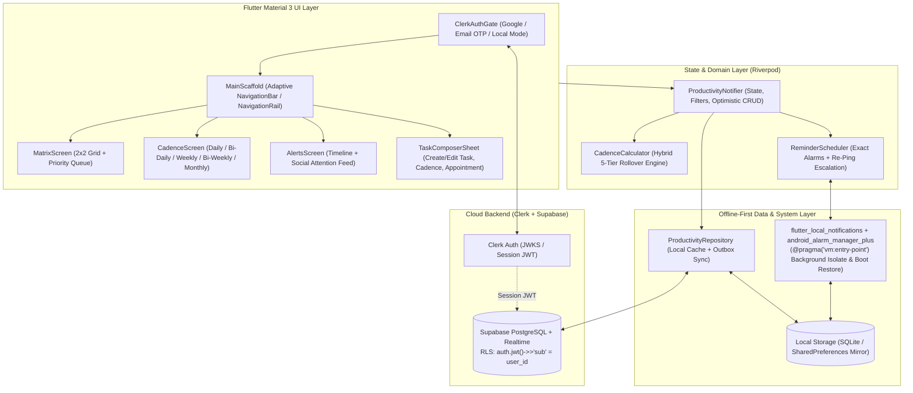

# CadenceFlow — Eisenhower Priority, Cadence Goals & Persistent Reminders (Flutter + Supabase + Clerk Auth)

CadenceFlow is a cloud-synced, offline-first **Flutter** productivity app built for daily execution on Android phones like the **itel Power 70** (and Web/PWA), combining Eisenhower Matrix task prioritization, multi-cadence goal scheduling (daily through monthly), and social-media-style persistent appointment reminders backed by **Supabase PostgreSQL** and **Clerk Auth**.

### User Review & Critical Decisions

> [!IMPORTANT]
> All core product and technical architecture decisions are locked into this plan: **Flutter (Material 3)** + **Supabase (PostgreSQL & Realtime)** + **Clerk Auth** + **Local Offline Alarm & Data Persistence**.

- **Cloud Sync & Identity (Confirmed — Clerk Auth + Supabase)**:
  - Authentication is powered by **Clerk Auth** (`clerk_auth` / `clerk_flutter`), supporting **1-Tap Google Sign-In**, **Passwordless Email OTP**, and **Email/Password** login.
  - Clerk session JWTs authenticate directly against **Supabase** via Supabase's native Third-Party Auth integration (`accessToken` callback), enforcing strict PostgreSQL Row Level Security (`(SELECT auth.jwt() ->> 'sub') = user_id`).
  - Includes a seamless **Offline-First Local Cache** (`sqflite` / `shared_preferences`) so the app works immediately out of the box and while offline, automatically syncing changes to Supabase when online.
- **Task Prioritization Model (Confirmed — Eisenhower Matrix)**:
  - Tasks use the **Eisenhower Matrix** (*Urgent vs. Important*) with four actionable quadrants—**Do First**, **Schedule**, **Quick Handle**, and **Defer**—paired with a focused Today Priority Queue.
- **Reminder & Notification Style (Confirmed — Persistent Social-Style Alerts + Offline Mirroring)**:
  - Reminders behave like **social-media-style persistent, attention-seeking alerts**—high-priority heads-up banners (`Importance.max` / `Priority.high`), unread badge counters, repeating follow-up escalation pings when unacknowledged, and inline **Done / Snooze 10m / Got It** actions directly from the notification shade.
  - Active alarm triggers and task/appointment states are mirrored in **local on-device storage** so `BOOT_COMPLETED` alarm restoration and background notification shade actions work **100% offline**.
- **Visual Theme & Palette (Confirmed — Teal & Amber Material 3)**:
  - **Clean, energetic Teal & Amber Material 3** aesthetic with distinct quadrant color cues, custom typography (`Outfit` + `Plus Jakarta Sans` + `JetBrains Mono`), and full Light/Dark mode support.
- **Cadence Rollover Behavior (Confirmed — Hybrid Interval & Anchor Engine)**:
  - **Interval Cadences (`DAILY`, `BI_DAILY`)**: When completed (even late), the next due timestamp advances relative to the **completion date** (`completedAt + 1 or 2 days`) to avoid overdue clutter.
  - **Calendar Cadences (`WEEKLY`, `BI_WEEKLY`, `MONTHLY`)**: Preserve the original **weekday / day-of-month calendar anchor**, stepping forward cleanly to the next future occurrence while incrementing the completion streak.

---

### 1. Overview & Core Concept

- **What It Does**:
  - **Prioritizes Daily Work**: Organizes tasks into the 4 Eisenhower Matrix quadrants (*Urgent & Important*, *Not Urgent & Important*, *Urgent & Not Important*, *Not Urgent & Not Important*) with one-tap quadrant switching and a ranked daily action list.
  - **Schedules Multi-Cadence Tasks & Goals**: Supports five explicit scheduling horizons—**Daily**, **Bi-Daily (every 2 days)**, **Weekly**, **Bi-Weekly (every 2 weeks)**, and **Monthly**—tracking cycle progress, streaks, and next due dates automatically.
  - **Delivers Persistent Appointment Alerts**: Schedules local device alarms (`flutter_local_notifications` + `android_alarm_manager_plus`) backed by locally mirrored and Supabase-synced appointment records, firing attention-seeking notifications with lead-time alerts, repeating follow-up pings if ignored, and an in-app urgent alert banner.
- **Target Audience / Persona**: Mobile-first users managing daily responsibilities, appointments, and recurring personal or work goals on Android devices (including budget/battery-focused phones like the **itel Power 70**) who need reliable reminders that do not get silently buried.
- **Key Value**: Bridges immediate daily firefighting, recurring multi-week goal consistency, and unmissable appointment notifications in one cohesive workspace synced safely to Supabase.

---

### 2. User Experience & Visual Design

- **Key User Flows**:
  1. **Clerk Sign-In & Instant Offline-First Hydration**:
     - On first launch, a branded welcome screen presents **Continue with Google**, **Passwordless Email OTP**, and an instant **Local Workspace Mode** fallback when unconfigured or offline.
     - Once authenticated via Clerk, local SQLite/storage hydrates the UI in `<10ms` while Supabase Realtime streams live remote changes in the background.
  2. **Today & Eisenhower Matrix (Home Tab)**:
     - Top summary strip shows active urgent reminder badges (social-feed style red/amber counter), today's completion ring, and quick quadrant filter chips.
     - Users toggle seamlessly between **Matrix Grid View** (interactive 2×2 Eisenhower quadrants with task counts and top items) and **Priority Queue View** (sorted Q1 → Q2 → Q3 → Q4).
     - Floating Action Button (`+`) opens a quick-capture modal sheet (`TaskComposerSheet`) to create a **Task**, **Cadence Goal**, or **Appointment** with quadrant toggles, cadence picker, and reminder lead times.
  3. **Cadence Planner (Cadences Tab)**:
     - Dedicated segmented selector for **Daily**, **Bi-Daily**, **Weekly**, **Bi-Weekly**, and **Monthly** horizons.
     - Displays cycle status (e.g., *"Due today"*, *"Every 2 days • 4-cycle streak"*, *"Next: Nov 29"*), progress bars per horizon, and one-tap **Complete Cycle** / **Edit Cadence** controls.
  4. **Appointments & Alert Feed (Alerts Tab)**:
     - Chronological timeline of upcoming appointments alongside an **Attention Feed** of active/unacknowledged reminders styled like high-visibility social mentions (avatar/category pill, timestamp, urgency tag, and direct **Acknowledge / Snooze 10m / Complete** buttons).
     - Includes a **Notification & Alarm Readiness Banner** that guides the user cleanly through granting `POST_NOTIFICATIONS` and `SCHEDULE_EXACT_ALARM` permissions on Android 13+ without blocking core app use.
  5. **Account & Preferences Sheet**:
     - Accessible from the top bar Clerk user avatar to view signed-in account details, sync status indicator (Synced / Offline Queue), toggle persistent re-ping intervals (every 5, 10, or 15 minutes until acknowledged), switch theme mode, or sign out cleanly.

- **Visual Identity & Theme**:
  - *Aesthetic Direction*: Clean, energetic, structured productivity—purposeful contrast and clear visual hierarchy without cluttered chrome.
  - *Color Palette & Mood*:
    - **Primary (`#00796B` / `#14B8A6`)**: Energetic Deep & Bright Teal for primary actions, active navigation pills, and progress indicators.
    - **Secondary / Accent (`#F59E0B` / `#D97706`)**: Warm Amber for urgent highlights, streak badges, and attention-seeking alert accents.
    - **Quadrant Semantic Tokens**:
      - **Q1 Do First**: Coral Red (`#E11D48`)
      - **Q2 Schedule**: Teal (`#0D9488`)
      - **Q3 Quick Handle**: Warm Amber (`#D97706`)
      - **Q4 Defer**: Cool Slate (`#64748B`)
    - **Surfaces**: Crisp Teal-tinted off-white (`#F5FAFA`) in Light Mode and Deep Slate-Teal (`#0C1618`) in Dark Mode with layered Material 3 surface containers.
  - *Typography & Hierarchy*: Google Fonts (`google_fonts`)—**Outfit** (SemiBold/Bold) for headings, quadrant titles, and metric counters; **Plus Jakarta Sans** (Regular/Medium) for task titles and notes; **JetBrains Mono** for due countdowns and timestamps.
  - *Component Styling & Layout*: Flutter Material 3 `Scaffold` with adaptive navigation (`NavigationBar` on compact phones like the itel Power 70, `NavigationRail` on wide screens/tablets), `SafeArea` compliance, minimum `48dp` interactive targets, and smooth implicit/explicit animations.

---

### 3. Key Product & Technical Decisions

- **Decision 1: Clerk Auth + Supabase Third-Party JWT Handshake**
  - *Chosen Approach*: Authenticate users via **Clerk** (`user_2x...` IDs) and pass the active Clerk session JWT into `SupabaseClient(..., accessToken: () async => clerkService.getToken())`.
  - *Why*: Eliminates custom token-exchange servers while allowing PostgreSQL RLS policies to verify `(SELECT auth.jwt() ->> 'sub') = user_id` natively.

- **Decision 2: Offline-First Local Storage Mirror + Supabase Cloud Sync**
  - *Chosen Approach*: Persist all `tasks`, `cadence_goals`, `appointments`, and scheduled alarm records in a local on-device store (`sqflite` / `shared_preferences`) with an outbox sync queue to Supabase PostgreSQL.
  - *Why*: Guarantees `<10ms` startup on the itel Power 70, 100% offline CRUD, and immediate local state access inside background notification action isolates (`Done` / `Snooze 10m`) and `BOOT_COMPLETED` receivers when network connectivity is unavailable.

- **Decision 3: Social-Media-Style Persistent Notifications & Escalation Alarms**
  - *Chosen Approach*: Use `flutter_local_notifications` with a dedicated `Importance.max` channel (`social_urgent_alerts`), `MessagingStyleInformation` / rich badge formatting, `ongoing: true` sticky flag for active urgent pings, inline action buttons (`DONE_ACTION`, `SNOOZE_10M_ACTION`, `ACK_ACTION`) handled by a `@pragma('vm:entry-point')` background callback, and scheduled follow-up re-ping alarms (`android_alarm_manager_plus` / zoned schedules) if unacknowledged.
  - *Why*: Delivers unmissable social-ping urgency while remaining 100% Google Play policy compliant.

- **Decision 4: Hybrid 5-Tier Cadence Engine (`CadenceCalculator`)**
  - *Chosen Approach*: Pure Dart calculator supporting `DAILY` (1d), `BI_DAILY` (2d), `WEEKLY` (7d), `BI_WEEKLY` (14d), and `MONTHLY` (calendar month clamp for 29th–31st).
  - *Rollover Logic*:
    - `DAILY` and `BI_DAILY` compute `nextDueAt` from `max(now, currentDueAt) + interval` so late completions start a fresh cycle from today.
    - `WEEKLY`, `BI_WEEKLY`, and `MONTHLY` advance in exact calendar steps from `currentDueAt` until `nextDueAt > now`, preserving the user's anchor weekday or day-of-month.

---

### 4. Technical Architecture & Supabase Schema

- **Architecture Diagram**:

- **Supabase PostgreSQL Schema (`supabase/migrations/001_initial_schema.sql`)**:
  - **`public.tasks`**:
    - `id` (`TEXT PRIMARY KEY`), `user_id` (`TEXT NOT NULL`), `title` (`TEXT NOT NULL`), `notes` (`TEXT NOT NULL DEFAULT ''`), `quadrant` (`TEXT NOT NULL CHECK (quadrant IN ('DO_FIRST','SCHEDULE','QUICK_HANDLE','DEFER'))`), `is_completed` (`BOOLEAN NOT NULL DEFAULT FALSE`), `due_at_millis` (`BIGINT`), `reminder_at_millis` (`BIGINT`), `is_persistent_alert` (`BOOLEAN NOT NULL DEFAULT FALSE`), `snooze_count` (`INT NOT NULL DEFAULT 0`), `created_at` (`TIMESTAMPTZ NOT NULL DEFAULT NOW()`), `updated_at` (`TIMESTAMPTZ NOT NULL DEFAULT NOW()`).
  - **`public.cadence_goals`**:
    - `id` (`TEXT PRIMARY KEY`), `user_id` (`TEXT NOT NULL`), `title` (`TEXT NOT NULL`), `notes` (`TEXT NOT NULL DEFAULT ''`), `cadence` (`TEXT NOT NULL CHECK (cadence IN ('DAILY','BI_DAILY','WEEKLY','BI_WEEKLY','MONTHLY'))`), `quadrant` (`TEXT NOT NULL CHECK (quadrant IN ('DO_FIRST','SCHEDULE','QUICK_HANDLE','DEFER'))`), `next_due_at_millis` (`BIGINT NOT NULL`), `last_completed_at_millis` (`BIGINT`), `streak_count` (`INT NOT NULL DEFAULT 0`), `reminder_hour` (`INT NOT NULL DEFAULT 9`), `reminder_minute` (`INT NOT NULL DEFAULT 0`), `is_persistent_alert` (`BOOLEAN NOT NULL DEFAULT TRUE`), `is_active` (`BOOLEAN NOT NULL DEFAULT TRUE`), `created_at` (`TIMESTAMPTZ NOT NULL DEFAULT NOW()`), `updated_at` (`TIMESTAMPTZ NOT NULL DEFAULT NOW()`).
  - **`public.appointments`**:
    - `id` (`TEXT PRIMARY KEY`), `user_id` (`TEXT NOT NULL`), `title` (`TEXT NOT NULL`), `location_or_link` (`TEXT NOT NULL DEFAULT ''`), `notes` (`TEXT NOT NULL DEFAULT ''`), `starts_at_millis` (`BIGINT NOT NULL`), `lead_minutes` (`INT NOT NULL DEFAULT 15`), `is_persistent_alert` (`BOOLEAN NOT NULL DEFAULT TRUE`), `reping_interval_minutes` (`INT NOT NULL DEFAULT 10`), `alert_status` (`TEXT NOT NULL CHECK (alert_status IN ('SCHEDULED','PINGING','SNOOZED','ACKNOWLEDGED','COMPLETED'))`), `snoozed_until_millis` (`BIGINT`), `created_at` (`TIMESTAMPTZ NOT NULL DEFAULT NOW()`), `updated_at` (`TIMESTAMPTZ NOT NULL DEFAULT NOW()`).
  - **Row Level Security (RLS)**:
    - Enabled on all three tables with `FOR ALL TO authenticated USING ((SELECT auth.jwt() ->> 'sub') = user_id) WITH CHECK ((SELECT auth.jwt() ->> 'sub') = user_id)`.
